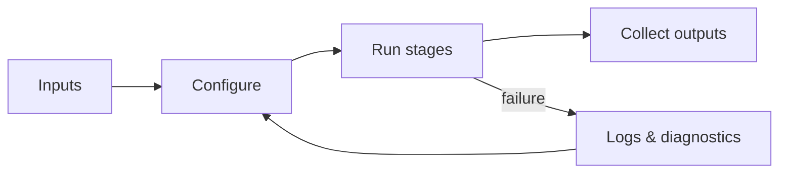

# How it works

What happens under the hood when the hep-pipeline runs.

!!! note "TODO — content pending"
    Placeholder outline. Real content lands in a later phase.

## Outline

- Pipeline stages at a glance
- Data flow between stages
- Inputs and outputs
- Failure handling

## Rendering check — diagram

*(Placeholder content — this diagram only exists so the Mermaid rendering can be
inspected. It will be replaced with the real stage graph.)*
